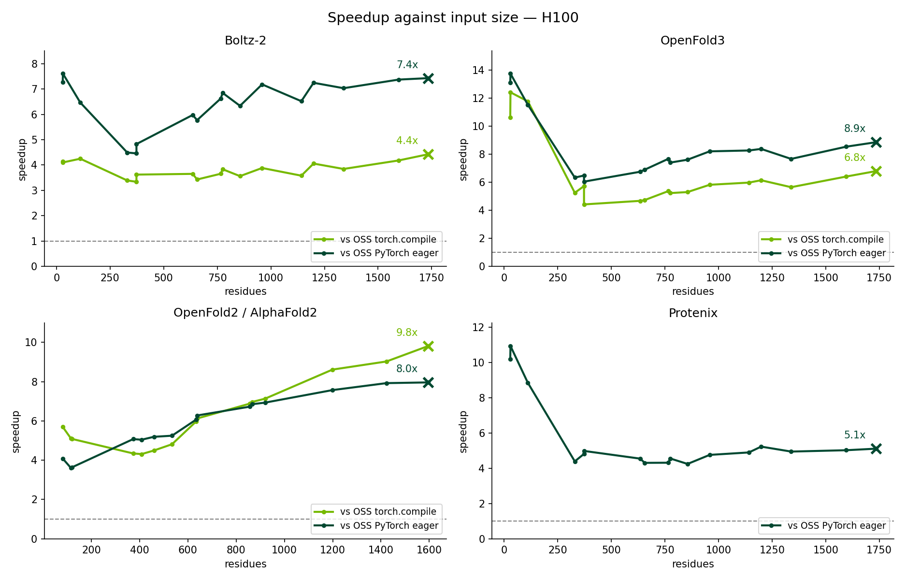

# Benchmarks

BioNeMo Inference Runtime (BioIR) measured against two OSS PyTorch baselines on
every GPU it is tested on. These are the numbers a run of the published
procedure should reproduce; they are not peak performance, and no attempt was
made to tune any configuration per GPU.

Both baselines are reported for every measurement, and the pair is the point.
Against OSS PyTorch eager, BioIR leads on every datacentre GPU and model here —
2.4x at worst. On GB10 it leads overall on every model, 1.14x at worst, but
Protenix there falls to parity above 512 residues (0.98x and 0.99x). Against OSS
torch.compile the answer depends on the architecture: 2.3-6.3x on Ampere, Hopper
and Ada, 2.3-5.2x on Blackwell, and 1.4-2.4x on GB10. Either baseline quoted
alone overstates the result in one direction or understates it in the other, so
figures below 1.00x are printed rather than dropped.

`torch.compile` is ahead on one individual measurement: the largest OpenFold2
multimer input, 1734 residues on GB10, at 0.94x. On Boltz-2, OpenFold3 and
OpenFold2 multimer the margin narrows with length on GB10, and on Boltz-2 and
OpenFold3 on Blackwell too, so long inputs there are the case to check before
quoting a single figure.

GB10 is a desktop part and reads like one: 128 GB of LPDDR5x at 273 GB/s shared
between CPU and GPU, an order of magnitude under HBM. It runs the same spec
13-26x slower than an H100, and BioIR's lead over both baselines is narrowest
there. It is reported because it is a supported target, not as a comparison
against the datacentre parts above it.

Per-sample speedup against input size, all four models on H100. The dashed line
is parity; crosses mark the largest input measured. The curves are far from flat
— high on the smallest inputs, where launch and dispatch overhead dominates and
BioIR has less of it, lowest in the few-hundred-residue range, then climbing
with length as the fused kernels start to matter. That shape is why every table
below is broken out by residue count, and why an overall geomean alone is not
enough to quote.

## Contents

- [Measurements](#measurements)
- [Boltz-2](#boltz-2)
- [OpenFold3](#openfold3)
- [OpenFold2 / AlphaFold2](#openfold2--alphafold2)
- [Protenix](#protenix)
- [RFProteína](#rfproteína)
- [Reproducing](#reproducing)

## Measurements

### Hardware

| Label        | Device                         | SM  | Memory  | Power limit | Driver     |
| ------------ | ------------------------------ | --- | ------- | ----------- | ---------- |
| `h100`       | NVIDIA H100 80GB HBM3          | 90  | 80 GiB  | 700 W       | 580.105.08 |
| `h200`       | NVIDIA H200                    | 90  | 140 GiB | 700 W       | 595.58.03  |
| `a100`       | NVIDIA A100 80GB PCIe          | 80  | 80 GiB  | 300 W       | 595.58.03  |
| `b200`       | NVIDIA B200                    | 100 | 179 GiB | 1000 W      | 595.58.03  |
| `b300`       | NVIDIA B300 SXM6 AC            | 103 | 269 GiB | 1100 W      | 595.58.03  |
| `gb200`      | NVIDIA GB200                   | 100 | 185 GiB | 1200 W      | 595.58.03  |
| `gb300`      | NVIDIA GB300                   | 103 | 278 GiB | 1400 W      | 595.58.03  |
| `l40s`       | NVIDIA L40S                    | 89  | 45 GiB  | 350 W       | 595.58.03  |
| `l40`        | NVIDIA L40                     | 89  | 45 GiB  | 300 W       | 595.58.03  |
| `l4`         | NVIDIA L4                      | 89  | 22 GiB  | 72 W        | 595.58.03  |
| `rtx6000ada` | NVIDIA RTX 6000 Ada Generation | 89  | 48 GiB  | 300 W       | 595.58.03  |
| `gb10`       | NVIDIA GB10                    | 121 | —       | —           | 595.58.03  |

One GPU per measurement, one process, no replicas. Absolute latencies move with
clocks, power limit and thermal headroom; the ratios are what should be
comparable. Below 256 residues, host-side launch and dispatch dominate OSS
latency, so OSS results there, and the speedups against them, also vary with CPU
speed.

### What Is Compared

Three backends fold the same inputs on the same GPU in the same container:

| Name              | What it is                                                                 |
| ----------------- | -------------------------------------------------------------------------- |
| BioIR             | This runtime: fused kernels, CUDA graphs, `torch.compile` where it applies |
| OSS torch.compile | The reference implementation under `torch.compile`                         |
| OSS PyTorch eager | The reference implementation, unmodified                                   |

The OSS side runs its own inference script: eager always, and `torch.compile`
additionally when it passes a dynamic-shape probe. Protenix has no compile path,
which is why its compile column is empty.

### Units

Speedup is `OSS forward / BioIR forward` per sample; above 1 favours BioIR.
Every figure is a **geometric mean of per-sample speedups**, not a ratio of
totals, so each sample counts equally regardless of how long it runs. `n` is the
sample count and differs by model.

Speedups are broken out by input size in residues because the spread is wide --
Boltz-2 on GB200 is 3.72x below 512 residues and 1.82x above 1024 against OSS
torch.compile. The overall geomean alone hides a factor of two.

Peak memory is `torch.cuda.max_memory_allocated` over the run. Accuracy is
OpenStructure lDDT over every sample and DockQ over the subset with a supported
protein interface.

## Boltz-2

| GPU          | vs OSS torch.compile | vs OSS PyTorch eager | &lt;512 res   | 512-1024 res  | &gt;1024 res  | n   |
| ------------ | -------------------- | -------------------- | ------------- | ------------- | ------------- | --- |
| `h100`       | 3.81x                | 6.35x                | 3.79x / 5.71x | 3.67x / 6.44x | 4.01x / 7.11x | 17  |
| `h200`       | 4.33x                | 6.19x                | 4.58x / 5.98x | 3.90x / 5.98x | 4.57x / 6.72x | 17  |
| `a100`       | 3.64x                | 5.39x                | 4.16x / 6.06x | 3.41x / 5.03x | 3.34x / 5.07x | 17  |
| `b200`       | 2.65x                | 3.91x                | 3.34x / 4.38x | 2.36x / 3.56x | 2.30x / 3.82x | 17  |
| `b300`       | 2.72x                | 4.41x                | 3.38x / 5.87x | 2.41x / 3.59x | 2.41x / 4.00x | 17  |
| `gb200`      | 2.28x                | 3.40x                | 3.72x / 5.41x | 1.68x / 2.57x | 1.82x / 2.73x | 17  |
| `gb300`      | 3.14x                | 4.72x                | 4.68x / 7.03x | 2.44x / 3.67x | 2.62x / 3.96x | 17  |
| `l40s`       | 3.79x                | 5.59x                | 4.16x / 5.52x | 3.48x / 5.37x | 3.76x / 5.96x | 17  |
| `l40`        | 2.73x                | 4.19x                | 3.86x / 5.22x | 2.42x / 3.53x | 2.08x / 3.94x | 17  |
| `l4`         | 3.29x                | 5.07x                | 3.30x / 4.21x | 3.36x / 5.83x | 3.05x / 5.84x | 14  |
| `rtx6000ada` | 3.16x                | 4.61x                | 4.45x / 6.11x | 2.55x / 3.76x | 2.73x / 4.20x | 17  |
| `gb10`       | 1.71x                | 2.75x                | 2.05x / 2.48x | 1.70x / 3.35x | 1.37x / 2.46x | 17  |

Bucket cells are `OSS torch.compile / OSS PyTorch eager`. Below 1.00x means the
baseline was faster.

### Forward Latency

| GPU          | BioIR   | OSS torch.compile | OSS PyTorch eager |
| ------------ | ------- | ----------------- | ----------------- |
| `h100`       | 3.35 s  | 12.74 s           | 21.27 s           |
| `h200`       | 3.15 s  | 13.64 s           | 19.51 s           |
| `a100`       | 7.90 s  | 28.73 s           | 42.55 s           |
| `b200`       | 3.63 s  | 9.61 s            | 14.20 s           |
| `b300`       | 3.52 s  | 9.57 s            | 15.53 s           |
| `gb200`      | 4.91 s  | 11.17 s           | 16.69 s           |
| `gb300`      | 3.44 s  | 10.79 s           | 16.23 s           |
| `l40s`       | 8.33 s  | 31.58 s           | 46.57 s           |
| `l40`        | 10.93 s | 29.83 s           | 45.77 s           |
| `l4`         | 16.97 s | 55.83 s           | 86.00 s           |
| `rtx6000ada` | 10.09 s | 31.92 s           | 46.52 s           |
| `gb10`       | 43.76 s | 74.62 s           | 120.48 s          |

Geomean of the per-sample forward time, over the samples the ratios above are
taken over. Quote these when comparing two releases: a ratio that moved does not
say which side did.

### Peak Allocated Memory

| GPU          | BioIR     | OSS torch.compile | OSS PyTorch eager | BioIR / compile |
| ------------ | --------- | ----------------- | ----------------- | --------------- |
| `h100`       | 20.34 GiB | 32.27 GiB         | 32.27 GiB         | 0.63x           |
| `h200`       | 20.34 GiB | 32.27 GiB         | 32.27 GiB         | 0.63x           |
| `a100`       | 20.30 GiB | 32.25 GiB         | 32.25 GiB         | 0.63x           |
| `b200`       | 19.59 GiB | 32.27 GiB         | 32.27 GiB         | 0.61x           |
| `b300`       | 19.59 GiB | 32.27 GiB         | 32.27 GiB         | 0.61x           |
| `gb200`      | 19.59 GiB | 32.27 GiB         | 32.27 GiB         | 0.61x           |
| `gb300`      | 19.59 GiB | 32.27 GiB         | 32.27 GiB         | 0.61x           |
| `l40s`       | 20.30 GiB | 32.25 GiB         | 32.25 GiB         | 0.63x           |
| `l40`        | 20.30 GiB | 32.25 GiB         | 32.25 GiB         | 0.63x           |
| `l4`         | 15.30 GiB | 16.44 GiB         | 16.44 GiB         | 0.93x           |
| `rtx6000ada` | 20.30 GiB | 32.25 GiB         | 32.25 GiB         | 0.63x           |
| `gb10`       | 19.59 GiB | 32.27 GiB         | 32.27 GiB         | 0.61x           |

Below 1.00x means BioIR allocates less than the baseline; above 1.00x means it
allocates more.

### Accuracy

| GPU          | lDDT                  | DockQ                 | n lDDT | n DockQ |
| ------------ | --------------------- | --------------------- | ------ | ------- |
| `h100`       | 0.667 / 0.665 / 0.664 | 0.611 / 0.606 / 0.601 | 17     | 9       |
| `h200`       | 0.667 / 0.664 / 0.663 | 0.611 / 0.609 / 0.617 | 17     | 9       |
| `a100`       | 0.662 / 0.660 / 0.663 | 0.613 / 0.608 / 0.610 | 17     | 9       |
| `b200`       | 0.663 / 0.661 / 0.663 | 0.613 / 0.611 / 0.610 | 17     | 9       |
| `b300`       | 0.669 / 0.660 / 0.664 | 0.606 / 0.601 / 0.605 | 17     | 9       |
| `gb200`      | 0.665 / 0.665 / 0.662 | 0.610 / 0.615 / 0.607 | 17     | 9       |
| `gb300`      | 0.669 / 0.667 / 0.665 | 0.608 / 0.614 / 0.611 | 17     | 9       |
| `l40s`       | 0.664 / 0.667 / 0.666 | 0.603 / 0.612 / 0.615 | 17     | 9       |
| `l40`        | 0.666 / 0.666 / 0.664 | 0.613 / 0.607 / 0.611 | 17     | 9       |
| `l4`         | 0.668 / 0.638 / 0.638 | 0.608 / 0.620 / 0.625 | 17     | 9       |
| `rtx6000ada` | 0.663 / 0.665 / 0.663 | 0.613 / 0.616 / 0.608 | 17     | 9       |
| `gb10`       | 0.666 / 0.662 / 0.667 | 0.604 / 0.604 / 0.611 | 17     | 9       |

Each cell is `BioIR / OSS torch.compile / OSS PyTorch eager`. lDDT is scored
over every sample; DockQ covers the subset with a supported protein interface,
which is why its count is lower. The three should agree -- a speedup that moved
them would not be the same answer.

## OpenFold3

| GPU          | vs OSS torch.compile | vs OSS PyTorch eager | &lt;512 res    | 512-1024 res  | &gt;1024 res  | n   |
| ------------ | -------------------- | -------------------- | -------------- | ------------- | ------------- | --- |
| `h100`       | 6.27x                | 8.20x                | 7.69x / 8.96x  | 5.17x / 7.41x | 6.18x / 8.33x | 17  |
| `h200`       | 5.63x                | 7.93x                | 6.93x / 8.57x  | 4.66x / 7.21x | 5.49x / 8.07x | 17  |
| `a100`       | 4.78x                | 6.27x                | 6.11x / 7.98x  | 3.99x / 5.39x | 4.41x / 5.62x | 17  |
| `b200`       | 4.26x                | 5.44x                | 5.81x / 6.78x  | 3.57x / 4.88x | 3.63x / 4.77x | 17  |
| `b300`       | 4.64x                | 6.09x                | 6.80x / 8.74x  | 3.80x / 5.08x | 3.73x / 4.92x | 17  |
| `gb200`      | 3.70x                | 4.47x                | 6.47x / 7.00x  | 3.00x / 3.58x | 2.44x / 3.40x | 17  |
| `gb300`      | 5.21x                | 6.57x                | 8.99x / 10.28x | 4.22x / 5.30x | 3.49x / 4.96x | 17  |
| `l40s`       | 5.54x                | 6.63x                | 6.99x / 8.77x  | 5.03x / 5.96x | 4.72x / 5.39x | 17  |
| `l40`        | 5.00x                | 6.04x                | 6.93x / 8.81x  | 4.32x / 5.12x | 4.02x / 4.67x | 17  |
| `l4`         | 4.39x                | 5.60x                | 4.39x / 5.60x  | — / —         | — / —         | 6   |
| `rtx6000ada` | 4.81x                | 5.99x                | 7.49x / 9.71x  | 3.96x / 4.87x | 3.58x / 4.31x | 17  |
| `gb10`       | 2.36x                | 2.89x                | 2.30x / 3.08x  | 2.72x / 3.25x | 2.04x / 2.33x | 17  |

Bucket cells are `OSS torch.compile / OSS PyTorch eager`. Below 1.00x means the
baseline was faster.

### Forward Latency

| GPU          | BioIR   | OSS torch.compile | OSS PyTorch eager |
| ------------ | ------- | ----------------- | ----------------- |
| `h100`       | 2.78 s  | 17.44 s           | 22.81 s           |
| `h200`       | 2.66 s  | 14.97 s           | 21.09 s           |
| `a100`       | 6.22 s  | 29.69 s           | 38.98 s           |
| `b200`       | 3.22 s  | 13.71 s           | 17.51 s           |
| `b300`       | 3.05 s  | 14.15 s           | 18.59 s           |
| `gb200`      | 4.34 s  | 16.06 s           | 19.39 s           |
| `gb300`      | 2.97 s  | 15.49 s           | 19.53 s           |
| `l40s`       | 6.28 s  | 34.78 s           | 41.62 s           |
| `l40`        | 7.92 s  | 39.58 s           | 47.78 s           |
| `l4`         | 3.42 s  | 15.01 s           | 19.16 s           |
| `rtx6000ada` | 7.26 s  | 34.92 s           | 43.51 s           |
| `gb10`       | 36.39 s | 85.71 s           | 105.25 s          |

Geomean of the per-sample forward time, over the samples the ratios above are
taken over. Quote these when comparing two releases: a ratio that moved does not
say which side did.

### Peak Allocated Memory

| GPU          | BioIR     | OSS torch.compile | OSS PyTorch eager | BioIR / compile |
| ------------ | --------- | ----------------- | ----------------- | --------------- |
| `h100`       | 22.14 GiB | 29.49 GiB         | 29.49 GiB         | 0.75x           |
| `h200`       | 22.14 GiB | 29.49 GiB         | 29.49 GiB         | 0.75x           |
| `a100`       | 22.10 GiB | 29.47 GiB         | 29.47 GiB         | 0.75x           |
| `b200`       | 21.39 GiB | 29.49 GiB         | 29.49 GiB         | 0.73x           |
| `b300`       | 21.39 GiB | 29.49 GiB         | 29.49 GiB         | 0.73x           |
| `gb200`      | 21.39 GiB | 29.49 GiB         | 29.49 GiB         | 0.73x           |
| `gb300`      | 21.39 GiB | 29.49 GiB         | 29.49 GiB         | 0.73x           |
| `l40s`       | 22.10 GiB | 29.47 GiB         | 29.47 GiB         | 0.75x           |
| `l40`        | 22.10 GiB | 29.47 GiB         | 29.47 GiB         | 0.75x           |
| `l4`         | 11.53 GiB | 8.40 GiB          | 8.40 GiB          | 1.37x           |
| `rtx6000ada` | 22.10 GiB | 29.47 GiB         | 29.47 GiB         | 0.75x           |
| `gb10`       | 21.39 GiB | 29.49 GiB         | 29.49 GiB         | 0.73x           |

Below 1.00x means BioIR allocates less than the baseline; above 1.00x means it
allocates more.

### Accuracy

| GPU          | lDDT                  | DockQ         | n lDDT | n DockQ |
| ------------ | --------------------- | ------------- | ------ | ------- |
| `h100`       | 0.617 / 0.616 / 0.619 | 0.533 / — / — | 17     | 9       |
| `h200`       | 0.617 / 0.617 / 0.612 | 0.533 / — / — | 17     | 9       |
| `a100`       | 0.616 / 0.616 / 0.618 | 0.533 / — / — | 17     | 9       |
| `b200`       | 0.618 / 0.616 / 0.614 | 0.535 / — / — | 17     | 9       |
| `b300`       | 0.618 / 0.619 / 0.617 | 0.532 / — / — | 17     | 9       |
| `gb200`      | 0.613 / 0.606 / 0.613 | 0.531 / — / — | 17     | 9       |
| `gb300`      | 0.614 / 0.619 / 0.618 | 0.530 / — / — | 17     | 9       |
| `l40s`       | 0.617 / 0.617 / 0.615 | 0.544 / — / — | 17     | 9       |
| `l40`        | 0.617 / 0.622 / 0.618 | 0.535 / — / — | 17     | 9       |
| `l4`         | 0.575 / 0.407 / 0.407 | 0.529 / — / — | 14     | 7       |
| `rtx6000ada` | 0.614 / 0.621 / 0.607 | 0.533 / — / — | 17     | 9       |
| `gb10`       | 0.611 / 0.620 / 0.619 | 0.538 / — / — | 17     | 9       |

Each cell is `BioIR / OSS torch.compile / OSS PyTorch eager`. lDDT is scored
over every sample; DockQ covers the subset with a supported protein interface,
which is why its count is lower. The three should agree -- a speedup that moved
them would not be the same answer.

## OpenFold2 / AlphaFold2

### Monomer

| GPU          | vs OSS torch.compile | vs OSS PyTorch eager | &lt;512 res   | 512-1024 res  | &gt;1024 res  | n   |
| ------------ | -------------------- | -------------------- | ------------- | ------------- | ------------- | --- |
| `h100`       | 6.08x                | 5.70x                | 4.81x / 4.39x | 6.26x / 6.32x | 9.14x / 7.82x | 15  |
| `h200`       | 5.98x                | 6.02x                | 4.67x / 4.70x | 6.27x / 6.70x | 8.88x / 7.97x | 15  |
| `a100`       | 4.11x                | 4.05x                | 3.60x / 3.68x | 4.07x / 4.10x | 5.49x / 4.81x | 15  |
| `b200`       | 4.49x                | 4.79x                | 3.76x / 3.89x | 4.35x / 5.10x | 6.77x / 6.40x | 15  |
| `b300`       | 4.21x                | 4.41x                | 3.19x / 3.16x | 4.34x / 5.03x | 6.95x / 6.57x | 15  |
| `gb200`      | 4.06x                | 3.85x                | 4.04x / 3.38x | 3.58x / 3.90x | 5.24x / 4.85x | 15  |
| `l40s`       | 3.09x                | 2.64x                | 2.64x / 2.46x | 2.84x / 2.63x | 4.97x / 3.04x | 15  |
| `l40`        | 2.93x                | 2.63x                | 2.76x / 2.74x | 2.59x / 2.47x | 4.24x / 2.76x | 15  |
| `l4`         | 2.40x                | 2.42x                | 1.91x / 2.12x | 3.02x / 2.77x | — / —         | 12  |
| `rtx6000ada` | 3.07x                | 2.88x                | 3.03x / 3.10x | 2.66x / 2.70x | 4.19x / 2.82x | 15  |
| `gb10`       | 1.60x                | 1.47x                | 1.27x / 1.39x | 2.03x / 1.71x | 1.61x / 1.22x | 15  |

Bucket cells are `OSS torch.compile / OSS PyTorch eager`. Below 1.00x means the
baseline was faster.

#### Forward Latency

| GPU          | BioIR   | OSS torch.compile | OSS PyTorch eager |
| ------------ | ------- | ----------------- | ----------------- |
| `h100`       | 1.39 s  | 8.44 s            | 7.91 s            |
| `h200`       | 1.28 s  | 7.66 s            | 7.72 s            |
| `a100`       | 3.56 s  | 14.65 s           | 14.43 s           |
| `b200`       | 1.42 s  | 6.38 s            | 6.81 s            |
| `b300`       | 1.44 s  | 6.07 s            | 6.35 s            |
| `gb200`      | 1.92 s  | 7.79 s            | 7.39 s            |
| `l40s`       | 4.43 s  | 13.69 s           | 11.70 s           |
| `l40`        | 5.20 s  | 15.25 s           | 13.68 s           |
| `l4`         | 8.93 s  | 21.46 s           | 21.64 s           |
| `rtx6000ada` | 4.76 s  | 14.61 s           | 13.70 s           |
| `gb10`       | 26.95 s | 43.24 s           | 39.61 s           |

Geomean of the per-sample forward time, over the samples the ratios above are
taken over. Quote these when comparing two releases: a ratio that moved does not
say which side did.

#### Peak Allocated Memory

| GPU          | BioIR     | OSS torch.compile | OSS PyTorch eager | BioIR / compile |
| ------------ | --------- | ----------------- | ----------------- | --------------- |
| `h100`       | 29.69 GiB | 15.27 GiB         | 15.27 GiB         | 1.94x           |
| `h200`       | 29.69 GiB | 15.27 GiB         | 15.27 GiB         | 1.94x           |
| `a100`       | 29.67 GiB | 15.25 GiB         | 15.25 GiB         | 1.95x           |
| `b200`       | 18.77 GiB | 15.27 GiB         | 15.27 GiB         | 1.23x           |
| `b300`       | 18.77 GiB | 15.27 GiB         | 15.27 GiB         | 1.23x           |
| `gb200`      | 18.77 GiB | 15.27 GiB         | 15.27 GiB         | 1.23x           |
| `l40s`       | 29.67 GiB | 15.25 GiB         | 15.25 GiB         | 1.95x           |
| `l40`        | 29.67 GiB | 13.00 GiB         | 13.00 GiB         | 2.28x           |
| `l4`         | 16.17 GiB | 13.00 GiB         | 13.00 GiB         | 1.24x           |
| `rtx6000ada` | 29.67 GiB | 15.25 GiB         | 15.25 GiB         | 1.95x           |
| `gb10`       | 23.56 GiB | 15.27 GiB         | 15.27 GiB         | 1.54x           |

Below 1.00x means BioIR allocates less than the baseline; above 1.00x means it
allocates more.

#### Accuracy

| GPU          | lDDT                  | DockQ     | n lDDT | n DockQ |
| ------------ | --------------------- | --------- | ------ | ------- |
| `h100`       | 0.434 / 0.426 / 0.432 | — / — / — | 15     | —       |
| `h200`       | 0.434 / 0.421 / 0.426 | — / — / — | 15     | —       |
| `a100`       | 0.434 / 0.422 / 0.422 | — / — / — | 15     | —       |
| `b200`       | 0.434 / 0.429 / 0.433 | — / — / — | 15     | —       |
| `b300`       | 0.434 / 0.427 / 0.426 | — / — / — | 15     | —       |
| `gb200`      | 0.433 / 0.432 / 0.429 | — / — / — | 15     | —       |
| `l40s`       | 0.432 / 0.431 / 0.426 | — / — / — | 15     | —       |
| `l40`        | 0.434 / 0.419 / 0.433 | — / — / — | 15     | —       |
| `l4`         | 0.481 / 0.424 / 0.417 | — / — / — | 15     | —       |
| `rtx6000ada` | 0.434 / 0.420 / 0.418 | — / — / — | 15     | —       |
| `gb10`       | 0.434 / 0.421 / 0.424 | — / — / — | 15     | —       |

Each cell is `BioIR / OSS torch.compile / OSS PyTorch eager`. lDDT is scored
over every sample; DockQ covers the subset with a supported protein interface,
which is why its count is lower. The three should agree -- a speedup that moved
them would not be the same answer.

### Multimer

| GPU          | vs OSS torch.compile | vs OSS PyTorch eager | &lt;512 res | 512-1024 res  | &gt;1024 res  | n   |
| ------------ | -------------------- | -------------------- | ----------- | ------------- | ------------- | --- |
| `h100`       | 5.27x                | 6.03x                | — / —       | 4.82x / 5.58x | 5.76x / 6.51x | 4   |
| `h200`       | 5.25x                | 6.09x                | — / —       | 4.80x / 5.65x | 5.75x / 6.57x | 4   |
| `a100`       | 3.17x                | 3.66x                | — / —       | 3.00x / 3.51x | 3.35x / 3.82x | 4   |
| `b200`       | 4.06x                | 4.84x                | — / —       | 3.51x / 4.26x | 4.70x / 5.49x | 4   |
| `b300`       | 4.10x                | 4.89x                | — / —       | 3.42x / 4.19x | 4.90x / 5.72x | 4   |
| `gb200`      | 2.94x                | 3.46x                | — / —       | 2.55x / 3.04x | 3.39x / 3.93x | 4   |
| `gb300`      | 4.16x                | 4.90x                | — / —       | 3.49x / 4.17x | 4.96x / 5.75x | 4   |
| `l40s`       | 2.74x                | 3.03x                | — / —       | 2.56x / 2.84x | 2.94x / 3.23x | 4   |
| `l40`        | 2.30x                | 2.54x                | — / —       | 2.16x / 2.41x | 2.45x / 2.68x | 4   |
| `rtx6000ada` | 2.32x                | 2.61x                | — / —       | 2.20x / 2.51x | 2.45x / 2.70x | 4   |
| `gb10`       | 1.43x                | 1.57x                | — / —       | 1.72x / 1.90x | 1.19x / 1.30x | 4   |

Bucket cells are `OSS torch.compile / OSS PyTorch eager`. Below 1.00x means the
baseline was faster.

#### Forward Latency

| GPU          | BioIR   | OSS torch.compile | OSS PyTorch eager |
| ------------ | ------- | ----------------- | ----------------- |
| `h100`       | 3.74 s  | 19.71 s           | 22.54 s           |
| `h200`       | 3.49 s  | 18.31 s           | 21.23 s           |
| `a100`       | 11.49 s | 36.40 s           | 42.05 s           |
| `b200`       | 3.68 s  | 14.97 s           | 17.81 s           |
| `b300`       | 3.52 s  | 14.43 s           | 17.24 s           |
| `gb200`      | 4.82 s  | 14.15 s           | 16.67 s           |
| `gb300`      | 3.36 s  | 14.00 s           | 16.48 s           |
| `l40s`       | 13.82 s | 37.90 s           | 41.90 s           |
| `l40`        | 17.58 s | 40.43 s           | 44.65 s           |
| `rtx6000ada` | 16.88 s | 39.24 s           | 44.01 s           |
| `gb10`       | 93.66 s | 133.90 s          | 147.23 s          |

Geomean of the per-sample forward time, over the samples the ratios above are
taken over. Quote these when comparing two releases: a ratio that moved does not
say which side did.

#### Peak Allocated Memory

| GPU          | BioIR     | OSS torch.compile | OSS PyTorch eager | BioIR / compile |
| ------------ | --------- | ----------------- | ----------------- | --------------- |
| `h100`       | 18.01 GiB | 14.04 GiB         | 14.04 GiB         | 1.28x           |
| `h200`       | 18.01 GiB | 14.04 GiB         | 14.04 GiB         | 1.28x           |
| `a100`       | 17.99 GiB | 14.02 GiB         | 14.02 GiB         | 1.28x           |
| `b200`       | 16.31 GiB | 14.04 GiB         | 14.04 GiB         | 1.16x           |
| `b300`       | 16.31 GiB | 14.04 GiB         | 14.04 GiB         | 1.16x           |
| `gb200`      | 16.31 GiB | 14.04 GiB         | 14.04 GiB         | 1.16x           |
| `gb300`      | 16.31 GiB | 14.04 GiB         | 14.04 GiB         | 1.16x           |
| `l40s`       | 17.99 GiB | 14.02 GiB         | 14.02 GiB         | 1.28x           |
| `l40`        | 17.99 GiB | 11.84 GiB         | 11.84 GiB         | 1.52x           |
| `rtx6000ada` | 17.99 GiB | 14.02 GiB         | 14.02 GiB         | 1.28x           |
| `gb10`       | 21.43 GiB | 14.04 GiB         | 14.04 GiB         | 1.53x           |

Below 1.00x means BioIR allocates less than the baseline; above 1.00x means it
allocates more.

#### Accuracy

| GPU          | lDDT                  | DockQ                 | n lDDT | n DockQ |
| ------------ | --------------------- | --------------------- | ------ | ------- |
| `h100`       | 0.784 / 0.736 / 0.766 | 0.603 / 0.601 / 0.610 | 4      | 4       |
| `h200`       | 0.784 / 0.762 / 0.761 | 0.603 / 0.591 / 0.606 | 4      | 4       |
| `a100`       | 0.777 / 0.750 / 0.777 | 0.597 / 0.617 / 0.620 | 4      | 4       |
| `b200`       | 0.783 / 0.766 / 0.774 | 0.607 / 0.610 / 0.606 | 4      | 4       |
| `b300`       | 0.783 / 0.756 / 0.779 | 0.607 / 0.609 / 0.620 | 4      | 4       |
| `gb200`      | 0.783 / 0.768 / 0.762 | 0.607 / 0.600 / 0.610 | 4      | 4       |
| `gb300`      | 0.783 / 0.768 / 0.774 | 0.607 / 0.635 / 0.621 | 4      | 4       |
| `l40s`       | 0.780 / 0.783 / 0.766 | 0.609 / 0.613 / 0.600 | 4      | 4       |
| `l40`        | 0.782 / 0.754 / 0.767 | 0.602 / 0.608 / 0.602 | 4      | 4       |
| `rtx6000ada` | 0.782 / 0.769 / 0.766 | 0.602 / 0.622 / 0.608 | 4      | 4       |
| `gb10`       | 0.780 / 0.756 / 0.773 | 0.602 / 0.613 / 0.625 | 4      | 4       |

Each cell is `BioIR / OSS torch.compile / OSS PyTorch eager`. lDDT is scored
over every sample; DockQ covers the subset with a supported protein interface,
which is why its count is lower. The three should agree -- a speedup that moved
them would not be the same answer.

## Protenix

| GPU          | vs OSS torch.compile | vs OSS PyTorch eager | &lt;512 res | 512-1024 res | &gt;1024 res | n   |
| ------------ | -------------------- | -------------------- | ----------- | ------------ | ------------ | --- |
| `h100`       | —                    | 5.37x                | — / 6.85x   | — / 4.45x    | — / 5.04x    | 17  |
| `h200`       | —                    | 5.03x                | — / 6.46x   | — / 4.21x    | — / 4.61x    | 17  |
| `a100`       | —                    | 3.90x                | — / 5.93x   | — / 3.10x    | — / 3.12x    | 17  |
| `b200`       | —                    | 3.54x                | — / 4.82x   | — / 2.96x    | — / 3.04x    | 17  |
| `b300`       | —                    | 4.27x                | — / 7.04x   | — / 3.23x    | — / 3.28x    | 17  |
| `gb300`      | —                    | 4.59x                | — / 7.78x   | — / 3.44x    | — / 3.43x    | 17  |
| `l40s`       | —                    | 3.74x                | — / 5.36x   | — / 3.17x    | — / 2.96x    | 17  |
| `l40`        | —                    | 3.06x                | — / 5.43x   | — / 2.32x    | — / 2.14x    | 17  |
| `l4`         | —                    | 3.00x                | — / 3.53x   | — / 2.67x    | — / 2.64x    | 14  |
| `rtx6000ada` | —                    | 3.16x                | — / 5.88x   | — / 2.31x    | — / 2.19x    | 17  |
| `gb10`       | —                    | 1.14x                | — / 1.51x   | — / 0.98x    | — / 0.99x    | 17  |

Bucket cells are `OSS torch.compile / OSS PyTorch eager`. Below 1.00x means the
baseline was faster.

### Forward Latency

| GPU          | BioIR    | OSS torch.compile | OSS PyTorch eager |
| ------------ | -------- | ----------------- | ----------------- |
| `h100`       | 4.59 s   | —                 | 24.64 s           |
| `h200`       | 4.44 s   | —                 | 22.34 s           |
| `a100`       | 11.44 s  | —                 | 44.64 s           |
| `b200`       | 4.99 s   | —                 | 17.69 s           |
| `b300`       | 4.67 s   | —                 | 19.94 s           |
| `gb300`      | 4.40 s   | —                 | 20.16 s           |
| `l40s`       | 12.27 s  | —                 | 45.87 s           |
| `l40`        | 16.67 s  | —                 | 51.00 s           |
| `l4`         | 26.11 s  | —                 | 78.40 s           |
| `rtx6000ada` | 15.03 s  | —                 | 47.50 s           |
| `gb10`       | 120.09 s | —                 | 137.41 s          |

Geomean of the per-sample forward time, over the samples the ratios above are
taken over. Quote these when comparing two releases: a ratio that moved does not
say which side did.

### Peak Allocated Memory

| GPU          | BioIR     | OSS torch.compile | OSS PyTorch eager | BioIR / compile |
| ------------ | --------- | ----------------- | ----------------- | --------------- |
| `h100`       | 27.57 GiB | —                 | 35.16 GiB         | —               |
| `h200`       | 27.57 GiB | —                 | 35.16 GiB         | —               |
| `a100`       | 27.55 GiB | —                 | 35.14 GiB         | —               |
| `b200`       | 33.19 GiB | —                 | 35.16 GiB         | —               |
| `b300`       | 33.19 GiB | —                 | 35.16 GiB         | —               |
| `gb300`      | 33.19 GiB | —                 | 35.16 GiB         | —               |
| `l40s`       | 27.55 GiB | —                 | 35.14 GiB         | —               |
| `l40`        | 27.55 GiB | —                 | 35.14 GiB         | —               |
| `l4`         | 17.42 GiB | —                 | 17.78 GiB         | —               |
| `rtx6000ada` | 27.55 GiB | —                 | 35.14 GiB         | —               |
| `gb10`       | 33.19 GiB | —                 | 35.16 GiB         | —               |

Below 1.00x means BioIR allocates less than the baseline; above 1.00x means it
allocates more.

### Accuracy

| GPU          | lDDT              | DockQ             | n lDDT | n DockQ |
| ------------ | ----------------- | ----------------- | ------ | ------- |
| `h100`       | 0.658 / — / 0.650 | 0.591 / — / 0.545 | 17     | 9       |
| `h200`       | 0.657 / — / 0.650 | 0.591 / — / 0.568 | 17     | 9       |
| `a100`       | 0.659 / — / 0.649 | 0.599 / — / 0.541 | 17     | 9       |
| `b200`       | 0.659 / — / 0.648 | 0.590 / — / 0.562 | 17     | 9       |
| `b300`       | 0.658 / — / 0.654 | 0.589 / — / 0.549 | 17     | 9       |
| `gb300`      | 0.659 / — / 0.653 | 0.589 / — / 0.555 | 17     | 9       |
| `l40s`       | 0.660 / — / 0.652 | 0.600 / — / 0.552 | 17     | 9       |
| `l40`        | 0.657 / — / 0.648 | 0.589 / — / 0.548 | 17     | 9       |
| `l4`         | 0.635 / — / 0.609 | 0.581 / — / 0.515 | 15     | 8       |
| `rtx6000ada` | 0.658 / — / 0.650 | 0.601 / — / 0.554 | 17     | 9       |
| `gb10`       | 0.658 / — / 0.652 | 0.601 / — / 0.552 | 17     | 9       |

Each cell is `BioIR / OSS torch.compile / OSS PyTorch eager`. lDDT is scored
over every sample; DockQ covers the subset with a supported protein interface,
which is why its count is lower. The three should agree -- a speedup that moved
them would not be the same answer.

## RFProteína

RFProteína is a design model rather than a folding model, so it runs on its own
harness and these figures are not comparable with the tables above. The unit is
**milliseconds per sampling step** on one `h100`, batch 1, 50 sampling steps, a
mid-peak recycling schedule for 170 trunk passes, and self-conditioning
disabled, across thirty sequence lengths from 64 to 1024 residues.

Each side is configured as it would be deployed rather than forced into a common
mould: the OSS implementation uses static `torch.compile` and pads every input
up to a released compile anchor, while BioIR runs the native length unpadded,
with exact-shape CUDA graphs through 512 residues and eager execution above.
Compilation, capture and warmup are outside the timed region.

BioIR is faster at all thirty shapes, with a median speedup of 2.03x over a
range of 1.28x to 3.35x.

| Residues | OSS pads to | BioIR mode |     OSS |   BioIR | Speedup |
| -------: | ----------: | ---------- | ------: | ------: | ------: |
|       64 |         128 | CUDA graph |  233.69 |   74.02 |   3.16x |
|      128 |         128 | CUDA graph |  225.74 |  103.16 |   2.19x |
|      256 |         256 | CUDA graph |  436.60 |  272.56 |   1.60x |
|      512 |         512 | CUDA graph | 1195.36 |  767.43 |   1.56x |
|      769 |         896 | eager      | 2983.93 |  889.79 |   3.35x |
|     1024 |        1024 | eager      | 2895.81 | 1489.11 |   1.94x |

Fourteen of the thirty measured shapes carry the pattern; six representative
rows are shown. Read the extremes with care. The largest speedups sit
immediately after an OSS compile anchor -- 769 residues padded to 896 gives
3.35x -- where much of the gain is padding waste on the OSS side rather than
BioIR being faster. Each row is a single timed rollout after warmup rather than
a median of repeats, so individual rows carry run-to-run noise. The sweep also
predates the removal of a short-sequence triangle-multiplication path, so rows
below 384 residues understate current BioIR performance, and it predates the
upstream thinking-mode schedules, so its fixed 50-step, 170-pass budget is not
what a default run executes today: the default is `thinking_medium`, 60 steps
over 185 trunk passes. Latency per sampling step stays the comparable unit;
total design time scales with the mode's trunk-pass count.

Peak **allocated** memory is lower for BioIR at long lengths, 10.74 against
15.56 GiB at 1024 residues, while peak **reserved** memory is higher, 38.69
against 33.62 GiB. That reflects caching-allocator behaviour under graph
capture rather than live tensor footprint, so deployments sized on reserved
memory should note the difference.

Design quality is reported separately in
[RFProteína architecture](rfproteina.md), because the comparison is
distributional rather than a per-sample score.

## Reproducing

These numbers are not tied to a build artifact: they come from `main`, on one
GPU, with public inputs and upstream baselines at pinned tags. The procedure is
the [`bench-perf-oss`](../../.agents/skills/bench-perf-oss/SKILL.md) agent skill
-- point an agent at it rather than following steps by hand. It installs BioIR
and each pinned baseline in isolation, runs one warmup and one timed forward per
sample, scores the output, and aggregates the geomeans above.

Have these ready first; the skill cannot supply them:

- **One NVIDIA GPU on driver 580 or newer.** The container ships a CUDA 13.2
  build of PyTorch. On a 535 driver it runs only through the
  forward-compatibility shim, and measuring on that path produced silent hangs
  and `SIGFPE` crashes part-way through a sweep -- wrong numbers, not merely
  slow ones. Check the ECC counters are zero while you are there.
- **`NGC_API_KEY` exported**, for the MSA Search NIM. `rebuild_dataset.py`
  builds the `dataset-0.3.0` inputs from RCSB and that endpoint rather than
  downloading a release; the structures need no credential at all
  (`--structures-only`). Free key at
  [build.nvidia.com](https://build.nvidia.com/). Every structure is checked
  against the coordinates that were measured. When RCSB has since revised an
  entry's coordinates (7PV5 in September 2026), the script takes the measured
  version from the wwPDB versioned archive instead.
- **`HF_TOKEN` exported.** OpenFold3's checkpoint is gated and an anonymous
  fetch returns `401`. Registering is free. Checkpoint staging generally is
  [Model Weights](model-weights.md).
- **A built extension**, per [Development Workflow](../dev.md).

When a ratio does not match, suspect the baseline environment before the code.
The most common cause by far is an upstream package resolved against a different
`torch` than BioIR's, at which point the ratio compares two PyTorch builds
rather than two implementations.

---

Container `nvcr.io/nvidia/pytorch:26.05-py3` · driver 580.105.08–610.57.04 ·
measured 2026-10-14
