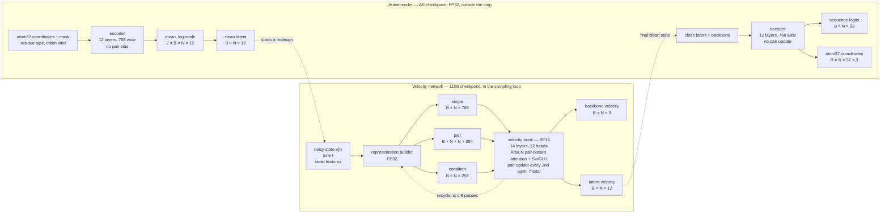
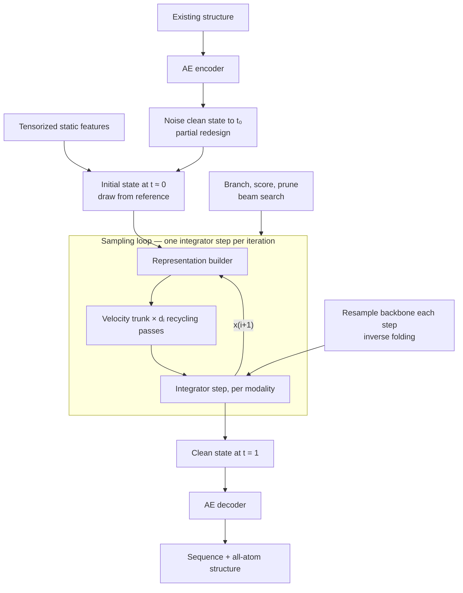

# RFProteína architecture

RFProteína (RFD4) is a generative protein-design model: one conditional
sampler replaces a per-task pipeline. This page describes what it generates,
the networks that generate it, and the kernels BioIR runs underneath. For the
design tasks and runnable commands, see
[Design Proteins with RFProteína](../advanced/design-with-rfproteina.md).

## What the model generates

RFProteína samples a **product state** of two modalities that share a token
axis of length $N$ and integrate jointly on independent schedules:

$$
X = \bigl(X^{\mathrm{bb}},\, X^{\mathrm{lat}}\bigr), \qquad
X^{\mathrm{bb}} \in \mathbb{R}^{B \times N \times 3}, \qquad
X^{\mathrm{lat}} \in \mathbb{R}^{B \times N \times d_z}
$$

$X^{\mathrm{bb}}$ holds backbone $\mathrm{C}_\alpha$ coordinates.
$X^{\mathrm{lat}}$ holds a per-residue latent of width $d_z$. The latent is the
code space of a separately trained autoencoder, so a frozen decoder maps a
clean $X^{\mathrm{lat}}$ to residue identity and all-atom geometry.

Two consequences drive everything below:

- Sequence is generated, not appended afterwards by a separate inverse-folding
  model, and it co-evolves with the backbone along the whole trajectory.
- The sampler never sees amino acids, only a $d_z$-dimensional continuous
  vector. The same Gaussian-interpolant machinery therefore covers sequence
  and geometry with no discrete-diffusion special case.

## Two networks around one state

Inference runs two networks, shipped as two checkpoints and trained in
sequence rather than jointly. At inference the only shape they share is the
latent width $d_z$.

- **The velocity network** (the LDM checkpoint) is the generative model. It
  maps a noisy product state and a time to a velocity per modality. It is the
  only network inside the sampling loop and is where essentially all inference
  time goes. Its checkpoint also carries the **representation builder**, the
  embedding and projection stack that turns conditioning annotations plus the
  current state into the three tracks the trunk consumes.
- **The autoencoder** (the AE checkpoint) defines what a latent *means*. The
  encoder maps an existing structure to clean latents; the decoder maps clean
  latents plus backbone positions to a sequence and all-atom geometry. Neither
  half runs in the loop.

Shapes below are the released values.



The pair track is the quadratic one, which is why triangle multiplication and
pair-biased attention are the hot kernels. The autoencoder is 256 wide on its
pair track and 128 on its condition track, and the released autoencoder is
unconditional, so its condition track is a learned constant carrying no input
information.

BioIR reads these shapes from the checkpoint tensor headers rather than from
the upstream config: the training base advertises a pair width of 512 and a
pair update every layer, and the promoted checkpoint does neither.

### Inside the velocity network

The representation builder emits a per-token **single** track, a
per-token-pair **pair** track, and a per-token **condition** track. The pair
track is $[B, N, N, 384]$, so it dominates memory and compute, and it is what
makes triangle multiplication and pair-biased attention the hot kernels.

The 14-layer stack is asymmetric. Each layer is adaptive-LayerNorm pair-biased
attention followed by a conditioned SwiGLU transition, with AdaLN-zero output
gates. Only every second layer is followed by a pair update, and only for the
first 13 layers, giving 7 pair updates. One pair update is a sequence-to-pair
injection followed by outgoing triangle multiplication, incoming triangle
multiplication, and a pair transition, each applied as a masked residual.

Recycling lives inside the network, not the sampler. When enabled, the trunk
starts from zeroed single and pair tracks and iterates: each pass adds a
normalized, linearly projected copy of the previous pass's output to the
builder's tracks and re-runs all 14 layers. Only the last pass reaches the
heads. The depth schedule is therefore a quality-versus-latency dial, not a
correctness setting.

## End-to-end inference



Only the boxed region repeats, and only the representation builder and the
trunk are network evaluations. The loop does not contain the encoder, the
decoder, structure writing, or metric evaluation — except under search, where
scoring runs at configured checkpoints. Profiling a design run and finding
autoencoder time on the critical path indicates a configuration bug, not a
performance problem.

The builder cannot be hoisted out of the loop: it consumes the current state
and time embedding alongside the static conditioning, so it re-runs every
step. What *is* loop-invariant is the purely feature-derived part of its work,
which BioIR precomputes once.

### Execution budget

One unconditional design costs one representation build and $d_i$ trunk passes
per sampling step, plus exactly one decoder pass. The step count and the
recycling depth schedule come from the chosen *thinking mode*, which is the
quality-versus-latency dial: upstream ships low, medium, and high, all at 60
sampling steps but totalling 110, 185, and 295 trunk passes respectively, with
medium as the default. Trunk passes, not steps, are what the runtime actually
spends.

Partial redesign and inverse folding add one encoder pass. Beam search
multiplies the loop cost by the branching factor at each checkpoint and adds
the evaluator cost, which for an external structure oracle can exceed the
entire sampling budget.

## Metric-weighted beam search

Search wraps the loop above without changing the velocity field or the state
update. It branches at configured step checkpoints, scores the branches, and
keeps the best ones:

```text
given checkpoints 0 = c[0] < c[1] < ... < c[K] = N,
      branch factor B, beam width M, weighted objective W

for m in 0..M-1:
    slot[m] <- initial state          # reference draw, or a clean state noised to t0

for k in 1..K:
    # branch: every surviving slot spawns B continuations of this interval
    for m in 0..M-1, b in 0..B-1:
        cand[b][m] <- segment(slot[m], from c[k-1] to c[k])

    # score: a candidate must be clean before it can be decoded
    if c[k] < N:
        scored <- segment(cand, from c[k] to N)   # completion, thrown away after scoring
    else:
        scored <- cand                            # already at t = 1

    metrics <- evaluate(decode(scored))
    reward  <- sum over weighted keys of w[i] * clip(metrics[i])

    # prune: keep the noisy branch point, not the completion that scored it
    slot <- top-M cand by reward, independently per request

return the surviving candidates
```

Four details are load-bearing rather than incidental:

- **The last interval is special.** Because the final checkpoint is the last
  step, its branched candidates are already denoised. No completion rollout
  runs and the survivors are not decoded twice — the predictions produced
  while scoring *are* the returned designs. At every earlier checkpoint the
  decoded prediction is discarded.
- **Scoring decodes a completion, not the branch point.** Candidates are
  ranked on what they would become, then the search rewinds and keeps the
  noisy state. That is what makes the completion rollouts pure overhead and
  why the branching factor multiplies cost so directly.
- **An invalid candidate scores minus infinity, not zero.** The objective sums
  weighted keys only; a weighted key that is missing, non-numeric, or
  non-finite rejects the whole candidate. Weighting a metric the features
  cannot produce — motif RMSD on an unconditioned chain, say — therefore
  rejects every candidate rather than ignoring the term. Zero-weight keys are
  skipped, so a metric can be disabled without being removed.
- **Selection is per request and stable.** Each row of the batch picks its own
  top M, and equal rewards keep the lower candidate index.

Search cannot create quality the field does not already produce; it re-ranks
trajectories rather than redirecting them. For the evaluator contract and the
runnable example, see
[Design Proteins with RFProteína](../advanced/design-with-rfproteina.md).

## Kernel support

Counts are per trunk pass, so multiply by the thinking mode's trunk-pass total
— 185 at the default medium setting — for a full design.

| Component                       | Backend           | Per pass  | Fused work                                   |
| ------------------------------- | ----------------- | --------- | -------------------------------------------- |
| LayerNorm / RMSNorm             | Triton rewrite    | all sites | norm, optional transpose and pad             |
| AdaLN                           | CuTeDSL to CUBIN  | 28        | norm, sigmoid scale, bias                    |
| Pair-biased attention           | CuTeDSL to CUBIN  | 14        | left-masked attention                        |
| Pair-bias projection            | Triton            | 14        | norm, project, moveaxis, pad                 |
| Gated sigmoid                   | CuTeDSL to CUBIN  | 42        | gate GEMM, sigmoid, multiply                 |
| SwiGLU transition               | CuTeDSL or Triton | 14        | dual GEMM, SiLU, multiply                    |
| Triangle multiplication, SM90   | CuTeDSL KF chain  | 14        | folded norms, gate, contraction, output gate |
| Triangle input gate, other SMs  | CuTeDSL `x_x`     | 14        | dual GEMM, sigmoid, mask, transpose          |
| Triangle contraction, other SMs | `torch.einsum`    | 14        | —                                            |
| Triangle output gate, other SMs | CuTeDSL `x0_x1`   | 14        | dual GEMM, sigmoid                           |
| Pair transition                 | CuTeDSL to CUBIN  | 7         | both linears, ReLU, mask, residual           |
| Masked residual                 | Triton            | 28        | add, mask                                    |
| Dense projections               | cuBLAS            | —         | —                                            |

Three points matter more than the individual rows. The triangle multiplication
has two implementations, and on SM90 — the released deployment target — it runs
as the fused KF chain described below rather than as three separate steps; the
`x_x` gate, `torch.einsum` contraction, and `x0_x1` gate are what the other SMs
run, where the dual-GEMM kernels fuse the gates on either side of the
contraction but not the contraction itself. Dense projections stay on cuBLAS,
because a library GEMM at these widths is already near roofline. And the
highest-count entry is not a GEMM but the gated sigmoid, at 42 invocations per
pass, a direct consequence of the architecture carrying three gates per layer.

### Triangle multiplication on SM90

On SM90 a supported node replaces the whole gate–contract–gate sequence with a
three-kernel chain, `trimul_kf_k1` into `trimul_kf_k2` into `trimul_kf_k3`:

- **K1** applies the input projection with the input LayerNorm folded into its
  weights, producing the gated operands.
- **K2** performs the contraction itself, compiled for one hidden width and one
  direction (outgoing or incoming).
- **K3** applies the output gate and projection with both LayerNorms folded
  into its weights.

Folding the norms into the projection weights is what removes the separate
normalization passes, and K2 is the reason the contraction is no longer an
`einsum` round trip on this architecture. The chain engages when the device is
SM90, the dtype is BF16, the owning model pads token axes to multiples of 8,
and a tuned tile ships for the node's `(dim, hidden_dim)` pair. RFProteína's
released pair width of 384 with a triangle width of 256 is one of those pairs,
so an H100 design run takes this path; a node that misses any condition falls
back to the three-step form in the table above.

### Dual-GEMM gates

The triangle multiplicative update and the SwiGLU transition share a shape:
project one or two inputs through two weight matrices, apply a nonlinearity to
one branch, and multiply. BioIR fuses each pair into one kernel in two
variants, distinguished by whether the two GEMMs share an input:

- `x_x` — one input, two weights:
  $\sigma(x W_g^\top + b_g) \odot (x W_p^\top + b_p)$. Used for the triangle
  *input* gate, where both projections read the normalized pair tensor, and
  for SwiGLU transitions, where the nonlinearity is SiLU.
- `x0_x1` — two inputs, two weights:
  $\sigma(x_0 W_g^\top + b_g) \odot (x_1 W_p^\top + b_p)$. Used for the
  triangle *output* gate, where $x_0$ is the normalized input pair tensor and
  $x_1$ the contracted hidden tensor — two tensors of two different widths,
  which is why the second variant exists.

The input-gate kernel also consumes the left-aligned pair mask as per-row
valid counts and can emit its output already transposed for the contraction,
absorbing masking and layout change. Row counts are computed once per forward
and reused by all 7 pair updates.

Not every candidate shape is worth fusing. The $(768, 3072)$ token transition
is the highest-count dual-GEMM request in the model, and it was tuned,
measured, and **rejected**: it reached only 0.38–0.74 times the throughput of
the existing fused projection plus Triton SwiGLU. A fused kernel wins by
avoiding a memory round trip on the intermediate, and at 3072 output columns
that intermediate is large enough that a well-tuned library GEMM plus a cheap
elementwise pass is simply better. Fusion is not monotone in the size of what
is fused.

### Dispatch and fallback

Every custom path is selected at runtime. For a dual-GEMM call: use CuTeDSL if
a tuned configuration exists for this `(K, N, gate)` on this SM and the mask is
left-aligned; otherwise, if the gate is not a sigmoid, fall back to two plain
GEMMs; otherwise try cuEquivariance for the shapes it covers; otherwise fall
back to two plain GEMMs. The attention backend is chosen the same way, with
CuTeDSL on SM80, SM86, SM89, and SM90 in half precision and
`F.scaled_dot_product_attention` everywhere else.

The pair transition has three levels rather than two. It first tries the fused
CuTeDSL transition kernel, which runs both linears, the ReLU, the mask, and any
residual in one launch and keeps the hidden activation on chip — tuned for SM80,
SM86, and SM89 with `cp.async` and for SM90 with TMA. If no tuned tile exists
for the requested `(width, hidden)` it falls back to a cuDNN operation graph
when one is enabled, and to ordinary linears otherwise. The released pair width
of 384 with an expansion of 2 is a tuned shape on every supported SM, so the
fused kernel is what actually runs; the token transition at 768 by 3072 is not,
which is the fallback in action rather than a gap.

One property inverts the usual expectation that a missing fast path degrades
gracefully. Dispatch commits to CuTeDSL based on the presence of a *tuning*
configuration, but execution needs a compiled *CUBIN*. In a source-free
deployment, a shape that has tuning but no packed binary raises rather than
falling back to PyTorch. Tuning and packaging must be kept in step.

## Measured results

**Numerical parity.** Against an FP32 upstream reference with BioIR also in
strict FP32 and TF32 disabled, across short, medium, and long monomers plus a
padded two-example batch, at recycling depths 1 and 5. Worst observed values:
velocity relative $L^2$ of $1.05 \times 10^{-6}$, decoded all-atom RMSD of
$5.17 \times 10^{-5}$ Å — four orders of magnitude below the 0.2 Å gate — and
exact sequence identity in every case. The encoder is excluded, so tasks that
start from an existing structure exercise a component this evidence does not
cover.

**End-to-end latency.** Reported in [Benchmarks](benchmark.md#rfproteína),
measured in milliseconds per sampling step across thirty sequence lengths,
together with the memory profile and the caveats that go with both.

**Design quality.** Three unconditional monomer inputs with 50 replicates each
give 150 designs per implementation, with zero failures on both sides. The two
distributions agree to well under a percentage point on secondary-structure
content and to parts in $10^5$ on geometry violations. These are unpaired
distributional summaries, not a matched-sample test: equal integer seeds do
not produce equal random tensors across two implementations.

## Related pages

- [Design Proteins with RFProteína](../advanced/design-with-rfproteina.md) —
  tasks, conditioning contract, and runnable examples.
- [Sampling architecture](sampling.md) — the shared rollout runtime the
  flow-matching integrator plugs into.
- [Custom structure oracles](oracles.md) — the provider contract used for
  search rewards.
