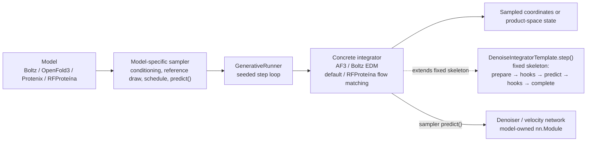

# Sampling architecture

BioNeMo Inference Runtime (BioIR) uses a Torch-native runtime for iterative
generative sampling. Model samplers own model-specific conditioning and
prediction calls, while `_torch/sampling` owns reusable rollout contracts,
iteration, random state, hooks, and integration algorithms.

## Overview



The Template Method separates the invariant `step()` skeleton from
algorithm- and model-specific operations. Each concrete integrator implements
those operations directly. OpenFold3 and Protenix use `AF3EDMIntegrator` with
tensor state, Boltz uses `BoltzEDMIntegrator` with structured state,
`FlowMatchingIntegrator` provides the default product-space flow, and
RFProteína specializes it with `RFProteinaFlowMatchingIntegrator`.

## Ownership boundaries

### Model

The top-level model owns trunk execution, model configuration, checkpoint
loading, and the denoising neural network. The denoiser remains an `nn.Module`
and is injected into the model-specific sampler:

```python
diffusion_module = DiffusionModule(config=...)
diffusion_sampler = ModelDiffusionSampler(
    config=...,
    diffusion_module=diffusion_module,
)
```

This keeps neural weights separate from rollout orchestration and allows
optimized submodules to be replaced through the model registry.

### Model-specific sampler

The sampler adapts the model to the shared runtime. It:

- prepares model-specific conditioning and masks;
- draws the initial state the rollout starts from;
- creates the rollout plan and `SamplingContext`;
- binds invariant tensors into a `predict(model_input, time)` closure;
- selects the concrete integrator and hooks;
- decodes the final runtime state into the model's public output.

The expensive denoiser call remains model-specific. The step loop does not.

### `GenerativeRunner`

`GenerativeRunner` owns algorithm-independent rollout mechanics:

1. initialize state through the integrator;
1. iterate for `integrator.num_steps(plan)`;
1. update `context.step_index`;
1. honor cancellation;
1. return `SamplingResult` with the final state and seed.

The runner does not know whether a prediction is denoised coordinates,
velocity, token logits, or a model-specific structured object.

### Integrator

`DenoiseIntegratorTemplate` fixes the denoiser-driven step order:

```text
prepare step
  -> before-denoise hooks
  -> extract model input and time
  -> predict
  -> attach prediction
  -> after-denoise hooks
  -> complete mathematical update
```

Concrete integrators implement this contract directly:

- `AF3EDMIntegrator` implements the AF3-style first-order EDM algorithm over
  coordinate tensors for OpenFold3 and Protenix.
- `BoltzEDMIntegrator` implements the same template for Boltz's structured
  state, including atom masks, previous denoised coordinates, and token
  representations.
- `FlowMatchingIntegrator` implements deterministic Euler over a dict of
  per-modality tensors with linear-interpolant clean endpoints.
- `RFProteinaFlowMatchingIntegrator` subclasses `FlowMatchingIntegrator` to
  supply mask-aware endpoints, the VF-TSR update, and rollout diagnostics.

None reimplements `step()`. Each supplies the template's typed operations:
initialization, step preparation, model inputs, prediction attachment, and the
mathematical update.

### Hooks

`DenoiseHookPipeline` applies ordered extensions around each prediction call.
Boltz uses hooks for:

- random rigid augmentation;
- churn-noise injection;
- potential guidance and particle resampling;
- token-representation accumulation;
- optional rigid alignment.

Hook constructors own rollout-local configuration and mutable state. Random
operations receive the explicit generator from `SamplingContext`.

## EDM step

The EDM implementation follows the first-order portion of Algorithm 2 from
Karras et al., [Elucidating the Design Space of Diffusion-Based Generative
Models](https://arxiv.org/pdf/2206.00364):

The initial coordinates are sampled at the largest noise level:

$$
\boldsymbol{x}_0 \sim
\mathcal{N}\!\left(\boldsymbol{0}, \sigma_0^2 \boldsymbol{I}\right).
$$

Each sampling step temporarily adds noise, invokes the denoiser, and advances
toward the next noise level:

$$
\begin{aligned}
\hat{\sigma}_i
    &= \sigma_i \left(1 + \gamma_i\right), \\
\boldsymbol{\epsilon}_i
    &\sim \mathcal{N}\!\left(\boldsymbol{0}, \boldsymbol{I}\right), \\
\hat{\boldsymbol{x}}_i
    &= \boldsymbol{x}_i
       + s_{\mathrm{noise}}
         \sqrt{\hat{\sigma}_i^2 - \sigma_i^2}\,
         \boldsymbol{\epsilon}_i, \\
\boldsymbol{x}^{\mathrm{denoised}}_i
    &= \mathrm{predict}
       \left(\hat{\boldsymbol{x}}_i, \hat{\sigma}_i\right), \\
\boldsymbol{d}_i
    &= \frac{
         \hat{\boldsymbol{x}}_i
         - \boldsymbol{x}^{\mathrm{denoised}}_i
       }{\hat{\sigma}_i}, \\
\boldsymbol{x}_{i+1}
    &= \hat{\boldsymbol{x}}_i
       + s_{\mathrm{step}}
         \left(\sigma_{i+1} - \hat{\sigma}_i\right)
         \boldsymbol{d}_i .
\end{aligned}
$$

In the implementation, `noise_scale` supplies the noise multiplier and
`step_scale` supplies the Euler-step multiplier.

This is the AF3/Boltz first-order adaptation, not the paper's full Heun
sampler. It intentionally omits Algorithm 2's second denoiser evaluation and
second-order correction. Churn gating, `step_scale`, rigid augmentation, and
model hooks follow model-specific inference algorithms.

## Model specializations

### OpenFold3 and Protenix

OpenFold3 and Protenix use:

- `EDMRolloutPlan`;
- `AF3EDMIntegrator`;
- a model-specific `predict` closure around their `DiffusionModule`.

Their differences remain in denoiser signatures, conditioning, schedule
termination, and optional caches.

### Frame-aware prediction reuse (Protenix, opt-in)

Protenix can skip some denoiser calls near the end of the rollout. This is an
**approximation of the denoiser**, not of the integration: every EDM update,
rigid augmentation and churn draw still happens, so the random streams are
unchanged. It is **off by default**, and its window (steps 160 to 197) is fixed
and was **only evaluated with the 200-step schedule** used in production.

Turn it on with the config field, and only there:

```python
config = Protenix.get_pretrained_config("protenix-v2")
config.edm_sampling_config.frame_reuse_period = 4  # 0 (default) is off; 1 is invalid
model = Protenix(model_name="protenix-v2", config=config, include_load_weights=True)
```

With `frame_reuse_period = p`, steps $160 \le i \le 197$ evaluate the network
when $(i - 160) \bmod p = 0$ and reuse the previous prediction otherwise. For
$p = 4$ that is 172 network calls and 28 reused predictions out of 200. Steps
before 160 (where churn injects noise) and the last two steps always evaluate
the network. Any other step count raises
`frame_reuse_period was only evaluated with 200 sampling steps; got N` before
the rollout starts, and so does a plan with coordinate augmentation off.

Ending the window at step 198 instead of 197 gave the same accuracy on 99 PDB
entries (median rms 0.0293 against 0.0292 Å versus the exact rollout), so
step 198 stays fresh only by convention; step 199, whose next noise level is 0,
has an error gain six times larger than its neighbours and stays fresh.

**What is reused.** Each step first applies a fresh rigid augmentation
$T_i(\boldsymbol{x}) = R_i(\boldsymbol{x} - \boldsymbol{c}_i) + \boldsymbol{t}_i$
to the persistent coordinates. The denoiser is equivariant, so its previous
output, given in the previous step's frame, is mapped through the current step's
$T_i$ instead of being recomputed. Only Cartesian coordinates are mapped; no
learned feature channel is reused.

```python
for i in range(n_steps):
    x, T_i = augment(x)                       # same random draws as without reuse
    x_hat = x + noise_i                       # churn is zero at every reused step
    if reuses(i):                             # start <= i <= end and (i - start) % p != 0
        D = T_i(D_prev)                       # map the previous prediction, no network call
    else:
        D = network(x_hat, sigma_hat_i)
    d = (x_hat - D) / sigma_hat_i
    x = x_hat + eta * (sigma_next_i - sigma_hat_i) * d
    D_prev = D                                # a mapped prediction is cached again
```

**Why the error stays small.** A prediction error $\varepsilon_i$ at step $i$
moves the next state by $a_i \varepsilon_i$ with

$$
a_i = \eta \left(1 - \frac{\sigma_{i+1}}{\hat{\sigma}_i}\right),
$$

and late steps have $\sigma_{i+1} \approx \hat{\sigma}_i$, so $a_i$ is small.
The staleness error $\varepsilon_i$ is the difference between the mapped
previous prediction and the one the network would give. If the remaining steps
do not amplify a perturbation (gain at most 1), the final coordinates differ
from the exact rollout by at most

$$
B = \sqrt{f^2 + \Big(\sum_{i \in \text{reused}} a_i \, \varepsilon_i\Big)^2},
$$

where $f$ is the numerical floor: any perturbation at steps $\ge 160$ re-rolls
TF32 rounding and moves the output by about 0.01 to 0.016 Å rms. The
$\varepsilon_i$ are measured per sample, so $B$ is a per-sample check, not a
guarantee; on the benchmark inputs and on 99 further PDB entries it held for
every sample. It bounds the rms displacement; it says nothing about single
atoms, a few of which can move by more than 1 Å (noise alone does this
for a fraction of samples too).

**Expected effect.** About 3 to 12 percent faster `model.forward` on the
benchmark inputs, less on large inputs (the saving is a fixed 28 denoiser
calls). Output is approximate: it is judged on paired lDDT / DockQ against
the exact rollout, not on bit equality
([oracles.md](oracles.md#approximate-options)). With the option off the output
is bit-identical to the exact sampler.

### Boltz

Boltz uses:

- `EDMRolloutPlan` with an appended terminal zero;
- `BoltzEDMIntegrator`;
- a model-specific ordered hook pipeline;
- a chunked `predict` closure around its injected `DiffusionModule`.

This preserves steering, resampling, alignment, token accumulation, and sample
chunking without duplicating the EDM loop.

## Flow-matching step

Flow matching transports a reference sample to a data sample along a
time-parameterized path. For the linear (conditional optimal-transport)
interpolant used here,

$$
\boldsymbol{x}_t = t\,\boldsymbol{x}_1 + (1 - t)\,\boldsymbol{x}_0 ,
$$

the network predicts the velocity `v = dx_t/dt`. One interval is an Euler step,
and the clean endpoint implied by a velocity follows from differentiating the
interpolant:

$$
\begin{aligned}
\boldsymbol{v}_i
    &= \mathrm{predict}\left(\boldsymbol{x}_i, t_i\right), \\
\boldsymbol{x}^{\mathrm{clean}}_i
    &= \boldsymbol{x}_i + \left(1 - t_i\right) \boldsymbol{v}_i, \\
\boldsymbol{x}_{i+1}
    &= \boldsymbol{x}_i
       + s_{\mathrm{step}} \left(t_{i+1} - t_i\right) \boldsymbol{v}_i .
\end{aligned}
$$

Time *increases* toward data at `t = 1`, the opposite direction to EDM's
decreasing noise levels. The clean endpoint is both a rollout output and, when
`self_condition` is enabled, the next step's self-conditioning input; it is
zero-filled before the first prediction, so self-conditioning is inactive on
step 0.

`GenerativeRunner.run_segment()` resumes any global interval range with an
explicit state. Continuation setup restores the caller's generator after
integrator initialization, and the first resumed prediction receives either
the parent's clean endpoint or explicit zeros according to
`carry_self_condition`. This makes checkpointed search independent of how
scoring work is chunked.

Sampling is *product-space*: a model may evolve several modalities on their own
time grids through one shared network evaluation, so states, times, and
velocities are keyed by modality name. `FlowMatchingRolloutPlan` requires every
modality to use the same number of intervals.

### Reference distribution

The rollout needs a sample at `t = 0` before the first interval. The shared
runtime does not draw it. Shapes, padding, and centering are model-specific in
a way generic code cannot guess, so `FlowMatchingIntegrator` accepts an
`initial_value` supplied by the model.

This keeps the two ends of the path in different layers: `_torch/sampling` owns
the transport from `t = 0` to `t = 1`, and the model owns what `t = 0` means.

### RFProteína

RFProteína uses:

- `RFProteinaProductSpaceFlowMatcher` for the `t = 0` draw;
- `FlowMatchingRolloutPlan` with one `FlowMatchingSchedule` per modality
  (`bb_ca` and `local_latents`), each carrying its own stochastic forcing rate;
- `RFProteinaFlowMatchingIntegrator`;
- a model-specific `predict` closure that builds representations from the
  current product-space state before calling the velocity network.

#### Product-space reference distribution

`RFProteinaProductSpaceFlowMatcher` draws the reference state one modality at a
time, in a fixed order, so a seed reproduces the same starting point exactly.

The draw is more than a Gaussian, because RFProteína centers it. The backbone is
projected onto the zero-center-of-mass subspace, since a translated backbone is
the same structure and the network should never have to learn that. *Stochastic
centering* then offsets tokens by a small random translation, which is what
teaches the model that absolute position carries no meaning. A scope decides who
moves together:

- `all` applies one offset to every token;
- `without_absolute_coords` leaves coordinate-conditioned tokens at the origin,
  since moving them would break the conditioning they carry;
- `per_group` gives each chain, molecule, or coordinate group its own offset, so
  the components of a complex are placed independently.

The `per_group` scope reads token groupings that `groups.py` extracts from the
static features, keyed by `chain_iid`, `pn_unit_iid`, `molecule_iid`, or
`coord_group`.

Each modality configures its own reference block, so the released checkpoint
centers the backbone and leaves the latents as plain masked noise. Latent width
comes from the checkpoint rather than the config, so the two cannot disagree.

#### Interval update

The sampler's prediction closure converts
`{modality: {"v": velocity}}` into the integrator's
`{modality: velocity}` contract and captures the optional insertion head.
`RFProteinaFlowMatchingIntegrator` specializes mask-aware clean endpoints, the
released Euler or VF-TSR update, latent masking, and optional trajectory
snapshots. Interval bookkeeping, self-conditioning handoff, iteration, and
random state remain shared.

The VF-TSR update is a stochastic extension of the Euler step above: it
converts velocity to the interpolant score, rescales the score by a
temperature ratio, and adds Brownian forcing on intervals where the time falls
inside the configured stochastic window.

## Source layout

```text
bionemo_ir/_torch/sampling/
  contracts.py             shared types, plans, context, and protocols
  runner.py                algorithm-independent rollout loop
  denoise_integrator.py    invariant denoiser-step ordering
  hooks.py                 ordered before/after-denoise hooks
  edm.py                   EDM schedule, math, and tensor integrator
  frame_reuse.py           opt-in frame-aware prediction reuse for Protenix
  flow_matching.py         flow schedule, math, and product-space integrator
```

Model-specific rollout code lives directly beside its model. For RFProteína:

```text
bionemo_ir/_torch/modules/rfproteina/
  sampler.py               RFProteinaProductSpaceSampler
  flow_matcher.py          product-space reference distribution and centering
  groups.py                token groupings for per-group centering
  schedules.py             per-modality time grids and forcing rates
  vf_tsr.py                velocity/score conversions and the VF-TSR step
  rollout.py               RFProteinaFlowMatchingIntegrator
```
